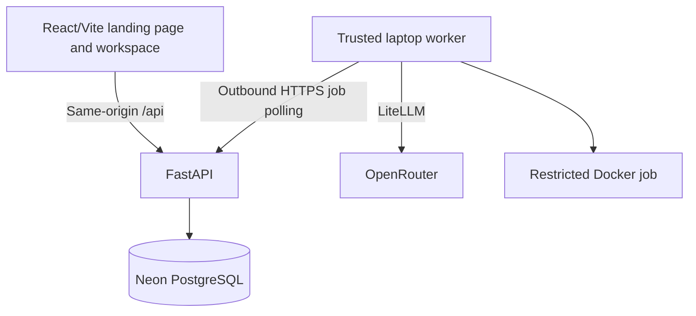

# Autonomous Agentic OS Prototype Blueprint

A simple CRM first build plan for three phases and four days

**Stack decision:** React with Vite is the current frontend. This plan supersedes the original frontend and hosting details.

Updated 14 November 2026. This is an implementation plan, not a claim that the application has already been built.

## What we are building

We will build a working internship prototype that turns a plain English request into a usable CRM tool. CRM means customer relationship management: keeping track of leads, companies, notes, and follow-up work. The goal is to show the whole process, not to build every feature in Zoho.

The main example is: Create a lead follow-up tool that finds leads with no activity for seven days and creates a follow-up task. The system will generate Python and a form description, test them in Docker, try to repair failures, let the reviewer activate the tool, and run it against sample CRM data.

The local version comes first. The public version uses hosted screens and a hosted FastAPI backend, while your laptop runs the Docker jobs. Your laptop must be on, connected, and running the worker for AI generation, semantic search, and generated-tool execution. Normal hosted CRM screens can still work while the worker is offline.

Build now
- Invite-only login for designated company email addresses, one demo workspace, and fake business data.
- Lead management, company relationships, activity notes, follow-up tasks, and basic search.
- Real AI generation, isolated QA, up to three attempts, progress updates, activation, execution, and rollback.
- One sponsored AI task per invited account; later AI tasks require the reviewer’s session-only OpenRouter key.
- A polished landing page, daily token and cost display, a public demo, and a local setup guide.

Done means a reviewer can log in, generate a tool, see real test results, activate it, use it, see a saved CRM change, and restore the previous version. Mock screens alone do not count.

## Architecture and responsibility

The frontend is the screen the reviewer uses. FastAPI is the trusted gatekeeper. Neon stores lasting data. A trusted worker on your laptop runs LangGraph and starts separate Docker containers for generated code. The containers never receive API keys or database passwords.

Use one React app built with Vite with two clear areas: the public landing page and the signed-in workspace. This keeps them easy to build separately without needing two deployments. Use relative /api paths. In development, the Vite proxy connects to FastAPI. For the hosted version, configure a fixed-host external rewrite for /api paths before the SPA catch-all. Verify session cookies and mutation origin checks on the hosted URL. Business rules remain in FastAPI.

The worker makes outbound HTTPS requests to claim jobs. Do not open a laptop port, expose the Docker socket, or add a public Docker API. A short-lived job lease means only the worker holding that lease can submit the result. FastAPI rejects late or duplicate results.

Generated tools receive a limited JSON snapshot and return JSON results plus proposed operations, such as create_followup_task. FastAPI checks those operations before writing to Neon. Generated code cannot run SQL, send email, install packages, or change the host application.

The diagram below shows the public setup. For local development, React/Vite and FastAPI also run on your laptop; Neon and OpenRouter remain online services. Therefore, local means locally running application services, not an offline product.

## System architecture diagram



## The free resource plan

Use free plans and existing hardware. Do not buy a domain, a paid database, paid file storage, or paid model credits for the assignment. Free plans have quotas and can stop serving requests; the UI must explain this honestly.

Service choices
- React/Vite and the landing page: Vercel Hobby, subject to its current eligibility and usage limits. Use the free provider URL. [S1]
- FastAPI: one Render Free web service. Render can sleep after 15 minutes without inbound activity, and wake-up can take about a minute. Its filesystem is temporary. Store durable state in Neon. [S2]
- Database: Neon Free only. The pricing page currently lists a zero-dollar tier. Keep the demo small and review the project dashboard before deployment. [S3]
- Code execution: Docker Desktop on your existing laptop, controlled by the trusted worker. This avoids assuming that a hosted Docker web service can launch safe nested Docker jobs.
- AI: LiteLLM SDK calling OpenRouter. Prefer verified free model entries from Qwen or DeepSeek when available; do not invent model IDs or assume every family has a free option. [S4, S5]
- Semantic search: a local embedding model on the trusted worker, with vectors stored in Neon. The proposed all-MiniLM-L6-v2 model produces 384-dimensional vectors. [S6]

Small source files, JSON UI definitions, and bounded diagnostics can live in Neon for v1. Avoid video uploads and large attachments. You will record the demonstration separately.

Free-only mode must refuse paid model fallbacks. A reviewer key does not make a paid model free. If no suitable free model is available, show a clear wait or retry message instead of charging silently. [S5]

## Login keys and the free task

There is no public signup. The owner creates an invited account for an exact company email address and gives the credentials to that person privately. Store password hashes, not passwords. Require a password change on first login. Use a maintained password-hashing library, an HttpOnly session cookie, expiry, logout, and login throttling.

One sponsored task means one accepted AI tool-generation run, including its internal repair attempts. Normal CRM browsing, edits, and invocation of a previously built tool do not consume another AI allowance unless they explicitly need a new model call. The sponsored allowance is per account for the whole demo, not per browser session or per day.

Reserve the allowance in a database transaction before starting the first provider request. Repeated clicks reuse the same run through an idempotency key. Refund only a failure proven to occur before any provider request was sent. An uncertain timeout must not automatically grant another sponsored run. The owner may explicitly reset an allowance for a demonstration.

Second-task popup
Your included AI task has been used. Please enter your own OpenRouter API key to continue. Your key is used only for this session and is not saved in our database.

Session agreement
I agree that my key will be used to send my requests to OpenRouter and its selected provider. This app keeps the key only in temporary memory while needed. It does not intentionally write my key to the database, logs, browser storage, or generated-code container. Provider data policies still apply.

Keep reviewer keys in browser and trusted service memory only. Never put them into LangGraph checkpoints. Clear references at logout, expiry, and job completion as appropriate; Python cannot promise cryptographic memory erasure. After a restart, request the key again. The owner’s sponsored key is a separate operator secret kept outside source control.

## Data and safe generated tools

Use PostgreSQL migrations and CREATE EXTENSION IF NOT EXISTS vector. The extension is called vector. Keep a small, explicit schema rather than allowing the AI to modify live database tables. [S7]

Main records
- users and sessions: invited identity, password hash, session expiry, and account status.
- entity_nodes: workspace, entity ID, entity type, name, timestamps, and version number.
- entity_traits: workspace, node ID, domain, schema version, and validated JSON attributes. The node reference cannot be null.
- entity_edges: relationships such as lead belongs to company. Both ends must belong to the same workspace.
- runs, run_events, and job_leases: status, attempt number, limits, progress, and worker ownership.
- tool_versions: Python source, UI definition, input/output schema, content hash, QA result, and activation status.
- usage_events and demo_allowances: per-call token/cost facts and the one-task allowance. Never store the API key here.

Use a unique workspace/node/domain rule for traits, useful lookup indexes, bounded JSON sizes, and optimistic locking so two edits cannot silently overwrite each other. Validate API inputs and generated output using Pydantic. Use database constraints for key relationships.

For semantic search, store the embedding model name, content version, and vector(384). Update vectors when source content changes. Search only the current workspace, using exact similarity for the small demo. Advanced vector indexes are not needed in v1. [S6, S7]

Each tool version has one fixed entry point: handle(input, context). Its Python code can process the provided snapshot but cannot contact the database. A stable API route chooses the active version. Activation changes a database pointer, not the FastAPI process or sys.modules. In-flight calls keep their original version.

## The AI workflow and its limits

Use LangGraph for a small workflow with a repair loop. A workflow with a loop is not a directed acyclic graph. Keep the router, generator, QA step, and final decision visible, but avoid extra agent hierarchies.

Run order
1. Check login, allowance or session key, model availability, and worker readiness.
2. Turn the request into a short structured requirement and choose the CRM domain.
3. Reserve an attempt, generate a versioned tool bundle, and validate its structure.
4. Run developer-owned tests and generated supplemental tests in Docker.
5. If tests fail and budget remains, give bounded diagnostics to the generator.
6. If tests pass, show the result for activation. Otherwise finish with a clear failure.

The attempt count starts at zero and increases before each generation attempt. Three means one initial attempt plus two repairs. A third successful attempt may continue. A third failure stops. Counters are owned by application code and saved outside the model prompt.

Starting limits for the prototype
- One active AI run per reviewer and one execution job at a time on the laptop.
- Three generation attempts; at most six provider requests including transient retries.
- 90 seconds per model request, 60 seconds per QA container, and ten minutes per run.
- 4000 output tokens per generation and 24000 total input plus output tokens per run.
- A 64 KiB raw diagnostic cap per attempt and a 2000-token repair diagnostic budget.

These are initial configuration values to test, not provider guarantees. Before every request, reserve its maximum possible token use. Stop rather than exceed the run budget. Set LangGraph recursion_limit explicitly and test that the graph fits it. A starting value of 15 is a secondary guard, not a count of model calls. [S8]

## Docker testing and error handling

The trusted worker owns Docker. Generated code does not. Start each QA or tool invocation in a fresh, fixed-image container with no network, a non-root user, a read-only root filesystem, bounded scratch space, all capabilities dropped, and no privilege escalation. Keep the default seccomp protection. Set CPU, memory, PID, and output limits. [S9]

Do not mount the project folder, personal files, credentials, or Docker socket. Copy a size-limited artifact into a temporary job area. Accept only expected filenames, reject path traversal and symlinks, and clean up in a finally block. An external timeout kills stuck code; a startup reaper removes abandoned containers.

Tests must cover the follow-up rule, an empty lead list, missing dates, invalid input, duplicate task prevention, and output permissions. The model may add tests but cannot replace the fixed acceptance tests. A trusted harness judges assertions; printing tests passed is not evidence.

Compact error feedback without another model call in v1. Keep the exception name, failing assertion, useful frames, and the latest failure. Remove repeated stack frames and secrets, then enforce the token limit. Persist a bounded redacted diagnostic record for inspection. Logs are data, not instructions to the agent.

If OpenRouter returns an invalid-key error, ask for a new key. If a free provider is busy, use a bounded delay or stop with a retry message. If the backend loses the session key, pause in needs_key. If the runner disconnects, expire its lease and show runner offline. Never mark a tool successful because the QA service failed.

Docker is a practical controlled-demo boundary, not a proof that arbitrary hostile code is harmless. Only invited reviewers and sample data are allowed in this version. Stronger public multi-tenant sandboxing belongs to the later roadmap.

## Phase 1 Build the usable foundation

Target day 1. Finish the easiest visible slice first: login, working CRM screens, real database persistence, and an initial landing page. No AI generation is needed to prove this phase works.

Build tasks
1. Create a repository with web, api, runner, contracts, and docs areas. Add a clear README and example environment files without secrets.
2. Pin compatible React/Vite, Python, FastAPI, Pydantic, LangGraph, LiteLLM, and database packages. Add lockfiles and basic build checks.
3. Create the Neon schema and repeatable fake-data seed. Create two invited test accounts in the single demo workspace.
4. Implement login, logout, first-login password change, CRM CRUD, input validation, and authorization checks.
5. Build lead list/detail, activity notes, company links, follow-up tasks, and search. Add loading, empty, and error states.
6. Create the landing-page structure and visual system. Build a simple real dashboard preview before adding visual polish.
7. Add placeholder run-status screens labelled as unavailable until the engine is connected. Do not present invented AI results as live.

Acceptance checks
- The allowed account signs in; an uninvited email cannot register.
- A lead created through the UI remains after page refresh and backend restart.
- Invalid data and unauthorized requests are rejected.
- A lead can link to a company and have an activity note and follow-up task.
- The frontend and backend start locally from the guide; migrations run on a clean Neon database.

Feedback checkpoint: review navigation, page readability, CRM fields, and the sample workflow. Fix those issues before connecting code generation. The detailed Markdown file contains the exact task order and API contracts.

## Phase 2 Make the AI journey real

Target day 2 and the first half of day 3. This phase is complete only when an actual model-generated tool survives QA and creates a valid CRM result.

Build tasks
1. Add LiteLLM calls to verified OpenRouter models, with an explicit per-request key. Never change a global key variable for a reviewer request.
2. Add the sponsored-task reservation and BYOK popup. Enforce a free-only model allowlist and per-account limits on the server.
3. Implement run records, outbound worker polling, leases, heartbeats, cancellation, and session-key delivery outside durable job payloads.
4. Build the graph and its three-attempt routing. Store code bundles by content hash. Add token accounting and bounded traceback handling.
5. Build the Docker QA harness and the isolated invocation path. Validate proposed CRM writes in FastAPI.
6. Build the JSON UI projector using an allowlist of text, number, date, select, and table components. No generated JavaScript or HTML execution.
7. Add manual activation, active-version lookup, previous-version rollback, semantic search, and the run timeline.

Acceptance checks
- Generate the seven-day follow-up tool and use it successfully with sample leads.
- A deliberately broken fixture demonstrates repair routing; label this as a test fixture, not a fabricated live model failure.
- A third failure stops. A third success can activate. Cancellation kills the container.
- A container cannot access the network, database credentials, API keys, or host project files.
- A second sponsored request requires BYOK, including after refresh or duplicate clicks.
- Duplicate invocation cannot create duplicate follow-up tasks. Activation uses the tested artifact hash.

Feedback checkpoint: improve the tool prompt, form fields, progress messages, and error explanations. Do not add new domains until this loop works.

## Phase 3 Publish polish and hand over

Target the second half of day 3, with day 4 reserved for fixes and demonstration preparation. Keep the public system invite-only.

Build tasks
1. Deploy the React/Vite frontend to a suitable free plan and FastAPI to Render Free. Keep Neon as the only durable database. Confirm current quotas in each account.
2. Configure exact frontend origins, secure cookies, trusted proxy routes, and protected runner credentials. Start the laptop worker and verify its heartbeat from the hosted app.
3. Show Online, Offline, Starting, and Needs key states honestly. A public page may be online while the execution worker is unavailable.
4. Finish the Solar-inspired SaaS landing page, real product screenshots, accessible mobile layout, and an obvious Launch demo button.
5. Add the daily usage panel with input/output tokens, provider-reported or estimated cost, model, and payer label: sponsored or your key. Display unknown usage as unknown, not zero.
6. Test local and public journeys, mobile layout, login expiry, rate limits, worker interruption, backend restart, rollback, and repeated tool use.
7. Finish the small guide and prepare the data for your own screen recording. Record the working build and label any saved examples accurately.

Release check
One invited reviewer completes the full journey on the public URL while the laptop worker runs. After the included task, a second AI task asks for a key. Logout removes access. No secret appears in browser storage, logs, database rows, screenshots, or error messages.

If a quota prevents the public demo, preserve the fully working local version and display the public limitation honestly. Do not silently replace generated execution with canned results or remove the local/public requirement from the handover.

## Landing page and the path to production

The product should feel quick and easy to understand. Zoho is the positioning reference, but do not claim we are faster than Zoho until both products have been measured on the same task.

Suggested hero copy
Turn a CRM task into a working tool.
Describe the workflow. Watch it build, test, and run in your workspace.
Primary action: Launch demo. Secondary action: See how it works.

Show a real preview, the three-step workflow, four working capabilities, an honest prototype comparison, a short architecture story, and an FAQ about keys and free limits. Do not invent customer logos, testimonials, uptime promises, or percentage savings. Use Solar as the layout and color reference. Its repository has conflicting license indicators; check the applicable license before copying template code or assets. [S10]

Measure our own experience: time to interactive screen, clicks to create a lead, time to first progress update, time to a tested tool, and warm versus cold backend latency. Display progress immediately even when generation takes longer. A useful target is fewer steps for the chosen follow-up workflow; it is not a validated competitor claim.

Approved for later
Kubernetes, autoscaling, microVM infrastructure, multi-region hosting, canary traffic splitting, full multi-company isolation, and advanced vector tuning are outside v1. Finance, HR, and collaboration remain future product domains because this build uses the selected CRM-only scope.

Before a real launch, move the runner to managed isolated infrastructure; add stronger tenant boundaries, secure secret management, production backups, monitoring, incident response, abuse controls, broader tests, and realistic service budgets. The existing artifact registry, stable API, and worker boundary make those changes possible without replacing the whole application.

## Terms and source notes

A few useful terms
- API: the agreed way one program asks another program to do something.
- Backend: the server that checks requests and handles business rules.
- JSON schema: rules describing the fields a message or form may contain.
- Ontology: our shared structure for business objects and their relationships.
- Embedding: a list of numbers that represents meaning for similarity search.
- Sandbox: a restricted environment used to run code away from the main service.
- Artifact: one saved, versioned bundle of generated code and its related files.
- Idempotency: repeating the same request does not repeat its business effect.
- Lease: temporary ownership of a job; it expires if the worker disappears.
- BYOK: bring your own API key. Here it means your OpenRouter key, not direct Qwen or DeepSeek credentials.

Source notes
Provider facts checked on 14 November 2026. Quotas, eligibility, and model availability must be checked again during setup. Technical designs and limit values are implementation decisions, not measured results.

[S1] Vercel Hobby documentation: https://vercel.com/docs/plans/hobby
[S2] Render free services: https://render.com/docs/free
[S3] Neon pricing: https://neon.com/pricing
[S4] LiteLLM OpenRouter integration: https://docs.litellm.ai/docs/providers/openrouter
[S5] OpenRouter free variants and limits: https://openrouter.ai/docs/guides/routing/model-variants/free and https://openrouter.ai/docs/api_reference/limits
[S6] Local embedding model: https://huggingface.co/sentence-transformers/all-MiniLM-L6-v2
[S7] pgvector: https://github.com/pgvector/pgvector
[S8] LangGraph Graph API: https://docs.langchain.com/oss/python/langgraph/graph-api
[S9] Docker security and limits: https://docs.docker.com/engine/security/ and https://docs.docker.com/engine/containers/resource_constraints/
[S10] Solar reference and repository: https://solar.tremor.so/ and https://github.com/tremorlabs/template-solar

## Detailed implementation contract

This section is the build checklist for Codex. Complete each phase, show the working result, collect feedback, and then continue. Do not replace a real integration with a mock to make a checklist pass. Limits below are initial settings and may be adjusted after a recorded test.

### Repository layout

```text
web/                 React/Vite landing page, workspace and local API proxy
api/                 FastAPI routes, validation, auth and database operations
runner/              Trusted worker, LangGraph flow, embedding service and Docker harness
contracts/           Versioned JSON schemas and fixture examples
tests/               Trusted acceptance cases and integration tests
docs/                Setup guide, architecture and short decision log
infra/               Dockerfiles and free-host deployment configuration
```

Use one repository. Landing-page work can proceed separately from backend work using shared contracts. The coding workflow may work on separate tasks, but changes must be integrated and tested before a phase is accepted. Do not assume fast code generation removes integration time.

### Phase 1 detailed tasks

- [ ] **P1.1 Project setup.** Create the areas above, `.gitignore`, `.env.example`, frontend/backend lockfiles, formatting tools and a basic CI build. Exclude `.env`, session dumps, credentials and local job folders. Pin compatible supported package versions after checking documentation; do not copy old version numbers from the original PDFs.
- [ ] **P1.2 Contracts first.** Define Lead, Company, Activity, FollowupTask, ToolBundle, RunStatus, ProposedOperation and ErrorResponse schemas. Add valid/invalid examples. Frontend types and backend validation must agree on IDs, dates, null fields and enum values.
- [ ] **P1.3 Neon setup.** Use the pooled database URL for ordinary requests and a direct URL for migrations when required. Keep small application connection pools. Use transactions for writes, statement timeouts, and UTC timestamps. Local and public builds use separate development/demo datasets or schemas so a local reset cannot erase the public demo.
- [ ] **P1.4 Data shape.** Nodes represent lead, company, activity and task. Traits store their domain fields. Edges connect lead-to-company and task/activity-to-lead. A small parent relationship model is enough; do not create a general graph query language. Store `workspace_id` everywhere needed, derive it from the authenticated account, and reject cross-workspace references.
- [ ] **P1.5 Field rules.** Leads need name, company link, contact email, stage, last-contact date and optional value. Tasks need title, due date, status, source lead and source invocation. Money-like demo fields use decimal values and explicit currency; they are not a financial ledger. Use an integer version for conflict detection. A stale update returns a conflict response rather than overwriting newer data.
- [ ] **P1.6 Invite login.** Owner-only provisioning takes an exact company email, creates a hashed initial password, and requires a password change. No public registration and no email-service dependency. Keep session records with expiry and revocation in Neon. Use a maintained auth/password library; do not invent cryptography. Login is throttled by account and coarse IP signal. The company email is an account identifier; manual provisioning is not automatic mailbox verification.
- [ ] **P1.7 Browser session.** The browser talks to the React/Vite origin. Vite proxies the fixed API paths locally. The public host rewrites /api paths to the configured FastAPI origin. Put the API rewrite before SPA history fallback. Use HttpOnly, Secure cookies in public deployment, SameSite protection, and Origin/CSRF checks for mutations. Never put the session token into localStorage. The local setup may use non-Secure localhost cookies only in explicit development mode.
- [ ] **P1.8 CRM routes and UI.** Implement paginated lists, detail, create, update, note entry and follow-up tasks. Use server-side permissions even if a button is hidden. Add meaningful empty states and keyboard labels. Update list/detail views after a successful write and handle optimistic-lock conflicts clearly.
- [ ] **P1.9 First visual pass.** Build the landing hero, product preview and workspace navigation. Use the Solar reference for design direction. Verify code/asset licensing before reuse; otherwise use original implementation and free components. Keep the product name Autonomous Agentic OS until the owner chooses another name.
- [ ] **P1.10 Acceptance.** Run frontend production build, backend validation/auth tests and one browser CRM journey. Restart the backend and confirm data persists. Record the working commands and phase feedback in docs. Commit the accepted slice.

**Phase 1 exit:** a reviewer account can use a real small CRM locally. AI buttons may show a clear not-connected state. It is not yet the final demonstration.

### Phase 2 detailed tasks

- [ ] **P2.1 Provider selection.** Use the LiteLLM SDK directly, not a separate LiteLLM proxy service. Pass `api_key` explicitly per call. Use `openrouter/<catalog-model-id>`. Fetch/inspect the current OpenRouter catalog and configure at most two tested free options, preferably Qwen/DeepSeek when available. Do not show unavailable options as working. Keep paid fallback disabled on both app and provider routing configuration.
- [ ] **P2.2 Secret boundary.** BYOK enters a password-style input and travels by HTTPS through the fixed-host API rewrite. It stays in browser memory and temporary trusted backend/worker memory. The database job contains only a credential reference. The authenticated job owner may attach a replacement key. Only the currently leased trusted worker can retrieve it. Never include a key in a URL, source bundle, checkpoint, diagnostic, usage row, analytics event or container environment.
- [ ] **P2.3 Key expiry.** Use a short session-memory TTL, initially 30 minutes idle. Preserve a key only as long as an authorized active job needs it. Logout cancels active jobs and requests cleanup; it cannot recall a provider request already sent. Service restarts cause `needs_key`, not retrieval from storage. Disable body/header logging on key endpoints and provider debug callbacks. Test two accounts simultaneously to detect key mixing. The owner-sponsored key stays in the trusted worker environment and is never returned to the browser.
- [ ] **P2.4 Allowance transaction.** `POST /runs` requires an idempotency key. Lock or atomically update the one-per-user allowance when choosing sponsored mode. Bind the reservation to one run ID. Repeating that request returns the same run. A second distinct run gets `key_required`. Reserve only when the runner is ready; do not consume allowance for a rejected input or clearly pre-provider failure. Keep refund events auditable and do not refund ambiguous dispatches automatically.
- [ ] **P2.5 Run state.** Support `queued`, `needs_key`, `generating`, `testing`, `repairing`, `awaiting_activation`, `succeeded`, `failed`, and `cancelled`. Keep worker availability as a separate status. Save timestamps, attempt count, remaining limits, artifact hash and safe error code. Durable state never contains an API key. Record run events with monotonic sequence numbers for polling/reconnect.
- [ ] **P2.6 Outbound worker.** A scoped runner secret authorizes job claim, heartbeat and result upload. Store its hash server-side. The trusted worker runs on the laptop and holds Docker access; containers do not. Start with one job at a time. Heartbeat every 10 seconds while active, a 30-second lease, and a 60-second offline threshold. The server clock is authoritative. Idle polling backs off; provide an explicit demo-mode start/stop command. Do not run artificial traffic just to bypass host idle policies.
- [ ] **P2.7 Lease recovery.** Include a lease token/generation in every result. Reject stale completions after reassignment. If the worker disappears during a provider request, mark that step uncertain and do not silently repeat it. QA can be rerun on an unchanged artifact. Business writes occur only in the server commit transaction with invocation idempotency, so lease expiry cannot duplicate tasks.
- [ ] **P2.8 Graph routing.** Use a short deterministic specification step, then generate -> QA -> decide. The only automatic code-repair edge returns to generate. Increment the durable attempt count before generation. Before each provider call reserve both remaining call count and maximum token use. A configuration/node bug must not reset these values. Check success before the post-QA failure-cap decision so the third successful attempt is accepted. Set an explicit recursion limit as a second fuse.
- [ ] **P2.9 Tool bundle.** Require `schema_version`, human name, description, Python source, entry point, input/output schemas, UI specification, allowed operation names and supplemental tests. Limit source size, file count and nesting. The trusted harness owns its tests separately. Reject unsupported imports and dynamic installation requests; static checking is a filter, not a substitute for isolation.
- [ ] **P2.10 Sandboxed execution.** Build one reviewed Python image with pinned dependencies and trusted bootstrap. Use a fresh container, non-root UID, no network, read-only root, bounded tmpfs, dropped capabilities, no-new-privileges, seccomp, CPU and memory limits. Starting limits: one CPU, 256 MiB memory, 64 PIDs, 32 MiB scratch, 60-second QA timeout, 30-second invocation timeout, 64 KiB captured output. Check that Docker/WSL actually enforces them; adjust only with evidence. Use no host project or socket mounts.
- [ ] **P2.11 Trusted result checking.** Treat all stdout and files as untrusted. Parse only the expected bounded JSON result; reject extra/oversized structure. Keep fixed test IDs, expected assertions and minimum coverage outside the generated bundle. An exit code of zero or printed success text is insufficient. Reject code that attempts to bypass the harness. Test and invoke the identical source hash and base-image digest.
- [ ] **P2.12 UI projector.** Support a fixed component set and schema version. Validate field names, nesting, enum lengths, required fields, and allowed action IDs. Render text safely. Reject raw HTML, script, arbitrary URLs, dynamic imports and file paths. Keep readable error messages when a model produces unsupported UI.
- [ ] **P2.13 Activation.** Activation requires authenticated reviewer confirmation and a passing QA record for the exact bundle. Update `active_version_id` transactionally with `expected_previous_version`. Do not execute source inside FastAPI. Keep the previous passing version for rollback. Rollback changes future execution; it does not undo already committed CRM records.
- [ ] **P2.14 Tool invocation.** Validate input, gather a bounded authorized CRM snapshot and enqueue execution. Generated code returns display data and allowed operations. FastAPI validates every operation against current data and permissions. Commit all operations atomically. A unique invocation/operation key prevents duplicate effects. Bound the maximum number of operations, initially 50; larger batches require another explicit run.
- [ ] **P2.15 Search and usage.** Run the local embedding model outside untrusted containers, pin its revision and use `vector(384)`. Re-embed only changed content; use exact workspace-filtered similarity. Query embedding jobs also require an online worker. Normal keyword search remains available. Store app-measured model-call tokens, cost, payer category and timestamp. The panel shows this app’s use, not all activity on the reviewer’s OpenRouter account.
- [ ] **P2.16 Failure matrix.** Test invalid key, unavailable free model, provider rate limit, third failure, third success, repeated output, oversized trace, worker crash, restart with missing key, invalid UI, cancellation, duplicate activation and duplicate task creation. Inspect database rows, logs and browser storage for test-secret leakage.

**Phase 2 exit:** real end-to-end generation and execution works locally. The two safety invariants are no generated code in the main API process and no secrets in generated-code containers.

### Phase 3 detailed tasks

- [ ] **P3.1 Free account review.** Confirm plan eligibility, no paid resources, no automatic paid model fallback, and current usage quotas. Do not start a paid trial as a substitute for a permanent free tier. Use provider subdomains. If a selected provider changes terms, record the alternative rather than making a silent paid upgrade.
- [ ] **P3.2 Public deploy.** Deploy web and API independently from the same repo. Use Neon environment secrets on the API only. Frontend public variables contain only public URLs. Keep the owner provider key on the trusted laptop worker. Do not install Docker-in-Docker on Render or execute user source there as a shortcut.
- [ ] **P3.3 Bridge and runner verification.** Verify HTTPS, exact trusted origins, cookie/CSRF handling, error redaction, route allowlists and runner token scope. Claim a hosted job from the laptop and complete it. Test replay of an expired lease token. Log run IDs and safe statuses without request bodies or keys.
- [ ] **P3.4 Landing content.** Sections: hero and dual CTA; real app preview; describe/build/use flow; leads/tasks/AI-tools/history cards; small architecture section; honest prototype FAQ; closing Launch demo CTA. No fake pricing tiers, customers, certification badges, revenue statistics or speed claims. Connect launch to the actual login screen, not a dead CTA.
- [ ] **P3.5 Usage and status UX.** Show runner connectivity, model choice, included-task remaining state, daily token total and cost with USD label. Use Asia/Kolkata calendar days for the user-facing daily display and UTC storage. Label estimates, partial usage and unknown provider results. A free-model confirmed zero cost may display $0.00; failed usage lookup may not.
- [ ] **P3.6 Screen states.** Include provider busy, expired session, missing key, worker offline, queued, testing attempt 2 of 3, test failed, ready to activate, active and rollback complete. Poll run events every two seconds only while needed; reconnect from the last event sequence. WebSocket transport can be added later without changing the run-event contract; v1 retains live progress through polling.
- [ ] **P3.7 Small performance check.** Seed 100 leads, 10 companies and realistic activities. Measure warm/cold latency separately. Target an immediate local UI response to a click and visible job acknowledgement within two seconds under normal warm conditions. Record generation time and repair count; do not promise a fixed model latency. Repeat a tool invocation 20 times and confirm no duplicate business effect or orphan containers.
- [ ] **P3.8 Public acceptance.** A fresh browser signs in, uses the included task, activates a real tested tool, sees the committed follow-up, then receives the BYOK prompt on the next AI task. Test with valid and invalid reviewer keys. Stop the laptop worker and confirm the UI reports unavailable rather than pretending work completed.
- [ ] **P3.9 Handover.** Replace proposed setup commands in the guide with commands actually tested on a fresh checkout. Include free-host URLs, environment variable names, database migration/seed steps, account provisioning, worker start/stop, resetting sample data, known limits and troubleshooting. Do not include real passwords or keys.
- [ ] **P3.10 Final review.** Check mobile and keyboard use, run targeted automated checks, record unresolved issues honestly, and preserve a tagged/committed demo build. The owner records the demo. Day 4 is a buffer for defects, not a new feature phase.

**Phase 3 exit:** local setup and public invite-only demonstration both work, with an online laptop worker and documented free-tier limitations.

## API and artifact contract

Paths below are proposed application contracts. Implement, test and document them; they are not existing endpoints.

| Route | Purpose and important rule |
|---|---|
| `POST /auth/login`, `/auth/logout`, `/auth/change-password` | Exact invited account, session issuance/revocation, first-login change |
| `GET /me` | Identity, workspace and sponsored allowance; never returns secrets |
| `GET/POST /crm/leads` and `PATCH /crm/leads/{id}` | Paginated CRM operations with schema validation and version checks |
| `POST /crm/leads/{id}/activities` | Add an activity; enforce parent ownership |
| `GET/POST /crm/tasks` | List/create follow-ups with business validation |
| `POST /session/provider-key` and `DELETE /session/provider-key` | Memory-only key attachment/removal; body logging disabled |
| `POST /runs` | Prompt, credential mode, model ID, idempotency key; returns 202 and run ID |
| `GET /runs/{id}` and `/runs/{id}/events?after=...` | Owner-authorized status and redacted progress |
| `POST /runs/{id}/cancel` | Mark cancellation and notify/poll worker cleanup |
| `POST /tools/{id}/activate` and `/rollback` | Passing immutable version, expected previous version, audit event |
| `POST /tools/{id}/invoke` | Bounded validated input, pinned active version, idempotent execution job |
| `GET /usage/daily` | Tokens and cost for this user in this app, with completeness status |
| `POST /runner/claim`, `/heartbeat`, `/complete` | Scoped runner auth, lease token, bounded result and stale-result rejection |
| `POST /runner/credential` | Current leased job only; retrieve live credential, never a general secret listing |

Use error codes the UI can act on: `key_required`, `invalid_key`, `free_model_unavailable`, `rate_limited`, `runner_offline`, `budget_exhausted`, `qa_failed`, `version_conflict`, `cancelled`. Avoid exposing raw provider payloads or host paths.

## Example acceptance workflow

Prompt: Create a follow-up tool for leads with no activity in seven days. Let me choose the inactivity threshold. Show the matching leads and create one follow-up task for each selected lead.

Trusted acceptance criteria:
1. Use an explicit current date supplied by the trusted context so tests are repeatable.
2. A lead with an activity yesterday is excluded; a lead inactive for eight days is included at a seven-day threshold.
3. Define the boundary as strictly more than the selected number of days and test the exact boundary.
4. A lead with no previous activity is judged using its creation date. Future or invalid dates are rejected or handled according to the fixed input schema, not guessed.
5. Empty input produces an empty list without failure.
6. The tool requests only `create_followup_task`, for selected authorized leads, with at most 50 operations.
7. Executing the same invocation twice creates only one task per lead. A later deliberate new invocation is a separate business action.
8. The generated UI renders supported fields only, and the tool uses the tested version.

## Simplifications and deferred work

The user approved moving advanced infrastructure out of v1. Do not quietly move core functionality into this list during coding.

| Feature | v1 treatment | Later upgrade |
|---|---|---|
| CRM | Complete selected end-to-end workflow | Broader CRM modules |
| Finance HR collaboration | Outside the selected CRM-only build | Domain-specific data integrity and features |
| Hot reload | Stable endpoint and version pointer; capability retained | Managed worker rollouts |
| Live progress | Poll durable events | WebSockets if needed |
| Context compaction | Deterministic bounded diagnostics | Quality-tested summarization if useful |
| Dynamic schema | Versioned validated JSON traits | Reviewed schema migration tooling |
| Queues | Neon job rows and leases | Dedicated queue when load requires it |
| Semantic search | Local embeddings and exact pgvector search | Measured ANN tuning |
| Public execution | Owner laptop worker during demonstrations | Managed isolated workers |
| Authentication | Invited accounts in one workspace | Organization SSO and verified invitations |
| Isolation | Restricted Docker and sample data | MicroVM/gVisor evaluation for hostile tenancy |
| Operations | Useful logs, manual rollback, small repeat tests | Full monitoring, backups, recovery drills and incident handling |

## Instructions to give Codex at each phase

### Phase 1 prompt

Implement Phase 1 only from this plan. Read the repo before editing. Build the real Neon-backed CRM and invite-only authentication, with a separate landing area in the same React/Vite project. Keep secrets out of source and logs. Add the shared contracts that Phase 2 needs. Run meaningful checks and show the working local flow. Report incomplete tasks and wait for feedback before expanding scope.

### Phase 2 prompt

Implement Phase 2 on the accepted Phase 1 build. Deliver actual OpenRouter generation through LiteLLM, three-attempt LangGraph routing, the sponsored/BYOK policy, outbound laptop worker, Docker QA, JSON UI, activation, invocation and rollback. Never execute generated Python in FastAPI. Never put provider credentials in Neon, graph checkpoints or containers. Test the failure matrix and demonstrate a real saved CRM effect.

### Phase 3 prompt

Implement Phase 3 on the accepted local build. Prepare free deployment configuration and publish only to authorized accounts and destinations. Verify the public workflow with the owner laptop worker. Finish the SaaS landing page using the selected visual direction and only assets/code permitted by their licenses. Complete usage/status UX and the tested guide. Do not add paid services or hide unavailable integrations. Provide the exact demo build and known limitations.

## Four day working schedule

Day 1: Phase 1 and feedback. Day 2: core Phase 2. Day 3 morning: complete Phase 2 and its failure checks. Day 3 afternoon: Phase 3 deployment and polish. Day 4: integration fixes, fresh-checkout guide test and owner-recorded demonstration. If a phase fails its acceptance check, fix it before adding polish; do not remove the safety or end-to-end requirements to meet the date.

## Final handover checklist

- [ ] Source repository and lockfiles, with no secrets.
- [ ] Working public landing page and invited application URL.
- [ ] Working local web/API/runner setup using Neon.
- [ ] Migration and deterministic sample-data seed.
- [ ] Reviewed Docker image and one command to start/stop the worker.
- [ ] Demonstrated real generation, testing, repair routing, activation, invocation and rollback.
- [ ] Demonstrated second-task BYOK gate and daily usage panel.
- [ ] Short guide updated with tested commands and known limitations.
- [ ] Owner-recorded demo showing the actual final build.
- [ ] Production roadmap retained without claiming those controls already exist.
